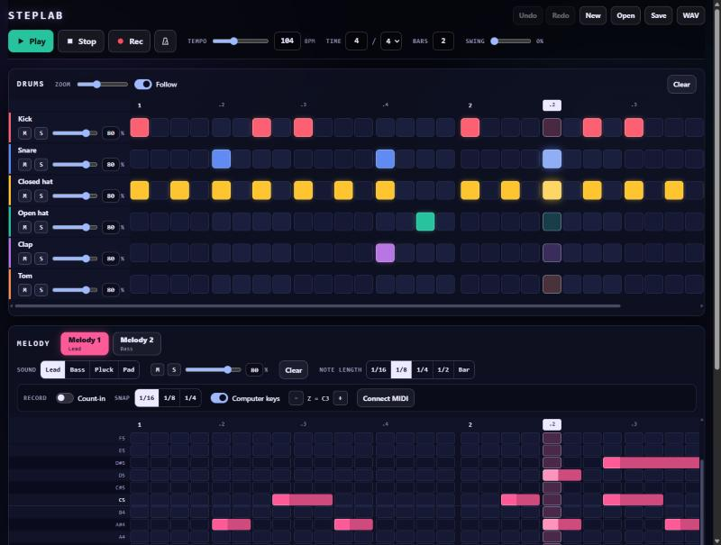

# Steplab

A small beat maker that runs in the browser. Program drums, draw or record two melodies, and export the loop as a WAV file. It takes the core of a music workstation like FL Studio and keeps it simple: anyone can make a beat in a few minutes, and there is room to grow once you do.

**Try it:** https://ethanmanco.github.io/steplab/



## What you can do

- **Drums:** six rows (kick, snare, closed hat, open hat, clap, tom). Click a step, or drag across steps to paint or erase several at once.
- **Melodies:** two tracks, each with a four octave piano roll. Pick a sound per track (Lead, Bass, Pluck or Pad). Click to place a note, drag right to make it longer, click a note to delete it. Stack notes on a step for chords. The other track shows faintly so the parts fit together.
- **Record:** play notes on a MIDI keyboard or your computer keyboard while the loop plays, like FL Studio. Notes land where you played them, snapped to 1/16, 1/8 or 1/4 notes, with the length you held them. A one bar count-in and a metronome help you come in on time.
- **Any loop:** type in the tempo (60 to 180 BPM), the number of bars (up to 16 bars of 4/4) and the time signature (any number of beats over 4 or 8, such as 3/4, 6/8 or 7/8). The whole loop is one long grid that fills the browser width and scrolls sideways, with bar and beat numbers along the top.
- **Feel:** swing pushes every second sixteenth late, up to a triplet shuffle.
- **Mix:** every track has mute, solo, a volume fader and a box where you can type an exact percent.
- **Transport:** Play doubles as Pause, Stop returns to the start, and the grid can follow the playhead. Zoom changes the step width.
- **Undo and redo** for every change. A whole recording take undoes in one step.
- **Save:** your beat autosaves in the browser. Save and Open move a project in and out as a JSON file. Projects from the first version open and upgrade automatically.
- **Export:** WAV renders the loop to a file that repeats seamlessly in other music apps.

## How to use it

1. Press **Click to start**. Browsers keep sound off until you interact with the page, so this is the moment audio switches on.
2. Click or drag in the drum grid, then press **Play**.
3. In **Melody**, choose a track tab and a sound. Pick a note length and click the piano roll, or drag to draw longer notes.
4. To record, press **Rec**, then **Play**. After the count-in, play notes with your MIDI keyboard (press **Connect MIDI** first) or your computer keyboard. They go into the melody track that is showing. Press **Ctrl+Z** to undo a take you did not like.
5. **Save** downloads your project. **WAV** downloads the audio.

### Keyboard

| Key | Action |
| --- | --- |
| `P` or `Space` | Play or pause (`Space` toggles a step when a grid square has focus) |
| `Esc` | Stop and go back to the start |
| `Shift` + `R` | Turn recording on or off |
| `Z` to `M` and `Q` to `U` | Play notes, laid out like piano keys (`S`, `D`, `G`, `H`, `J` and `2`, `3`, `5`, `6`, `7` are the black keys) |
| `-` and `=` | Move the computer keyboard down or up an octave |
| Arrow keys | Move between steps in a grid |
| `Space` or `Enter` | Turn the focused step or note on or off |
| `Shift` + Left or Right | Make the focused note shorter or longer |
| `Home` / `End` | Jump to the start or end of a row (with `Ctrl`, the corners of the grid) |
| `Ctrl` + `Z`, `Ctrl` + `Shift` + `Z` | Undo, redo |
| Left and Right on the melody tabs | Switch tracks |

Each grid is a single Tab stop, so Tab moves between controls instead of through thousands of squares. Every square is a real button with a spoken label such as "Kick, bar 2, step 5, on" or "Melody 1, C sharp 4, step 9, note, 3 steps long".

## How it's built

- **Vite + TypeScript**, with plain DOM code and no UI framework. A small element helper and a tiny store do the job. The grids only touch the squares that changed, so even a 16 bar loop (almost 14,000 buttons) rebuilds in about 60 ms and a single edit takes about 1 ms.
- **[Tone.js](https://tonejs.github.io/)** for audio scheduling and synthesis.
- **Every sound is synthesized in code.** There are no audio samples, so there are no licensing questions. The kick is a pitch-swept sine with a noise click, hats are FM metal synths through a high-pass filter, the clap is three quick noise bursts plus a tail, and the melody sounds are polyphonic subtractive and FM synths.
- **Web MIDI** for keyboards, in Chrome, Edge and Firefox (Safari does not support it).
- **Vitest** for the timing, pattern, recording, file, MIDI and WAV logic.

### Audio scheduling

Timing is the part that makes or breaks a sequencer. JavaScript timers drift and stall whenever the page is busy, so nothing here plays a sound "now".

1. Tone's transport runs on the Web Audio clock, which keeps time on the audio thread. A single `Tone.Loop` fires once per sixteenth note, **slightly ahead of time** (Tone's look-ahead window).
2. Each callback receives the exact future `time` that step will be heard. It asks the transport which tick that time falls on and turns it into a loop step (`stepFromTicks`). Reading the step from the clock instead of counting callbacks means it can never drift, and changing tempo, loop length or time signature mid-play just works.
3. A pure function, `eventsAtStep(project, step)`, lists the drum hits and notes that start on that step, honoring mute and solo. Every sound is started **at `time`** (plus the swing delay on off-beat sixteenths), so the audio hardware plays it sample-accurately even if the main thread is late.
4. The playhead is drawn with `Tone.Draw`, which runs the visual update when that `time` is actually reached, so what you see matches what you hear.

### Recording

Recording has the opposite problem: the music you hear is already a moment old. When a key goes down, the engine works out where the music is **as heard** (the audio clock minus the output latency) and stores that position in steps. When the key comes up it does the same, so the note gets its real length, even across the loop end. The start then snaps to the chosen grid. Live notes play straight through the track's synth so you hear yourself with no extra delay.

### WAV export

The export builds the exact same audio graph inside Tone's offline context and renders it faster than real time. The loop is rendered **twice** and only the second pass is kept: it already contains the tails (pad releases, open hats) that spill over from the end of the first pass, just like when the loop repeats live. The result is a seamless loop. A small encoder writes 16-bit stereo PCM at 44.1 kHz.

### Saving

Projects are versioned JSON tagged with `"app": "steplab"`. Opening a file repairs small problems (tempo out of range, notes off the roll, unknown sounds) and refuses anything that is not a Steplab project, with a plain message. Autosave writes to `localStorage` after each pause in editing and when the tab is hidden. Every storage call is wrapped in `try/catch`, and if storage is blocked the app says so and keeps working.

### Accessibility, phones and the look

- Real buttons, labels, roving focus, visible focus rings and a status message for each action.
- `prefers-reduced-motion` turns off every transition and the blinking record light.
- On small screens the grids scroll sideways inside their panels with the track names pinned, and touch targets are at least 40 px. Tapping toggles; dragging scrolls.
- A dark deep-space theme: a still, seeded starfield painted once on a canvas, with soft nebula light behind the panels. Nothing in the background moves.

## Project layout

```
src/
  core/       pure logic, fully tested: timing, patterns, notes, schedule,
              recording, keyboard map, undo history, MIDI messages, files, WAV
  audio/      Tone.js: drum kit, instruments, shared graph, live engine, offline render
  ui/         DOM: step grid, drum grid, piano roll, transport, controls, starfield
  midi.ts     Web MIDI connection
  storage.ts  safe autosave and settings
  main.ts     wires state, audio, input and UI together
tests/        Vitest specs for everything in core/ plus storage and grid keys
```

## Run it locally

```bash
npm install
npm run dev
```

```bash
npm test
```

```bash
npm run build
```

Pushing to `main` runs the tests, builds the site and deploys it to GitHub Pages with the workflow in `.github/workflows/deploy.yml`.

## Future ideas

Deliberately left out so far:

- Recording audio
- Importing your own samples
- Effects such as reverb and delay
- A song arrangement timeline with several patterns
- More tracks
- Accounts and sharing

## Credits

Built with Claude Code. I designed, directed, reviewed, and tested it.
